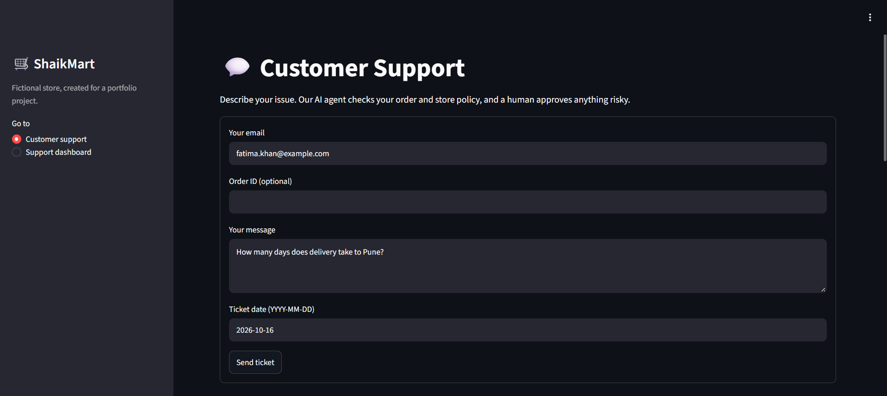
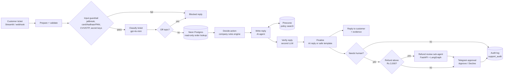
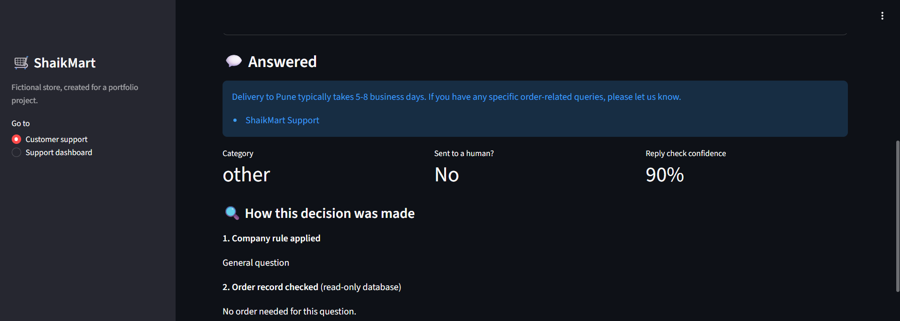
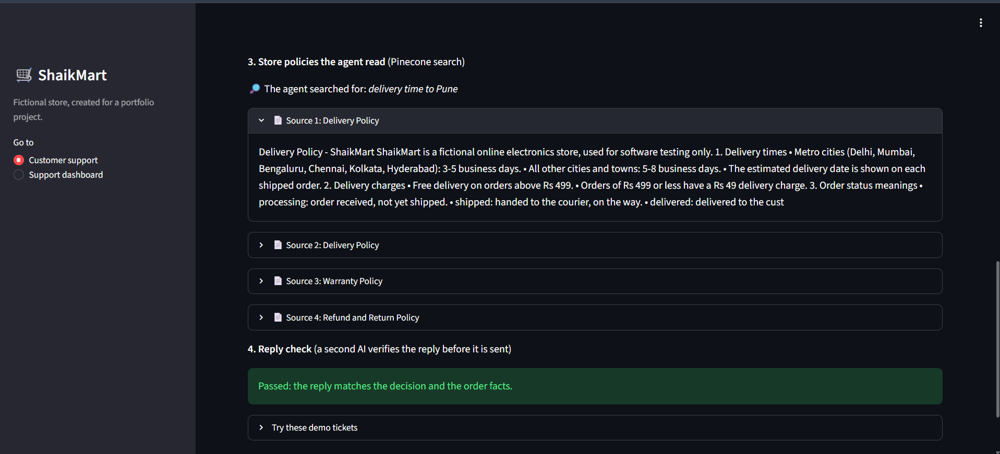
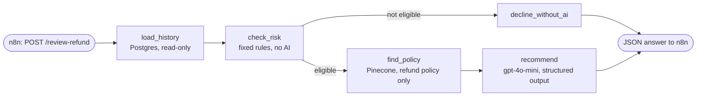
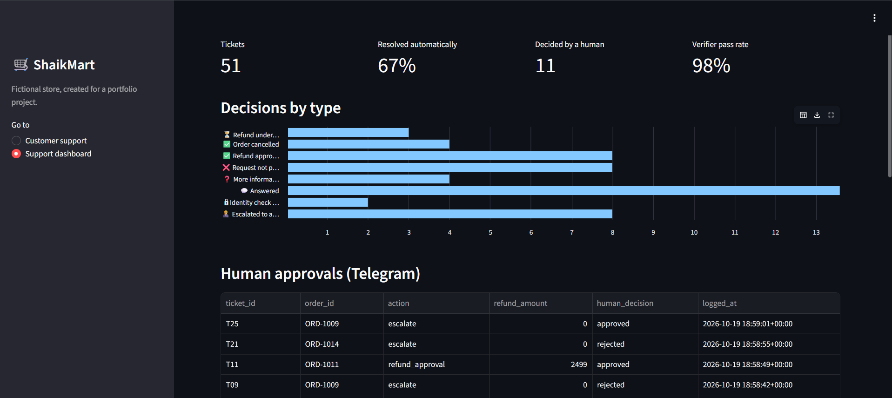
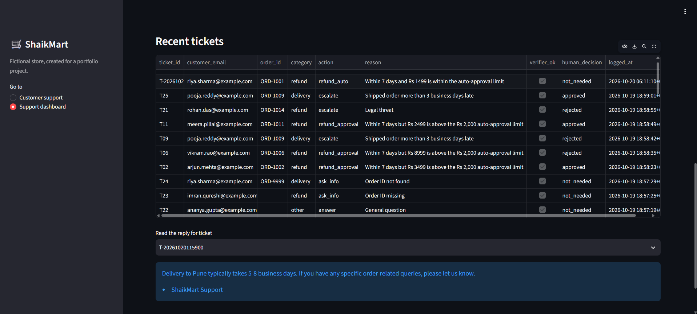

# ShaikMart Support Resolution Agent

An AI customer-support agent for **ShaikMart**, a fictional Indian electronics store. It reads a customer ticket, checks the order in the database, looks up store policy, decides what to do (refund, cancel, deny, escalate, ask for info), writes the reply, checks the reply with a second AI, and asks a human on Telegram before anything risky.

Built mostly as **low-code n8n workflows**. Python is used for the evaluation script, the Streamlit UI, and a **LangGraph refund review sub-agent** served with **FastAPI**.

> **Result: 25/25 correct decisions and 22/22 key facts** on a 25-ticket test set covering refunds, escalations, identity checks, Hinglish/Hindi messages and prompt-injection attacks.



---

## Why this design

Letting an LLM decide refunds is risky: it can be talked into things, and it can make up policy. So the work is split:

| Who | Does what |
|---|---|
| **Company rules** (a JavaScript Code node) | Decide **what** to do: refund, deny, escalate… The same input always gives the same decision. |
| **AI writer** (agent + policy search tool) | Only writes the **words** of the reply, using the decision, the order facts and the store policies. |
| **AI verifier** (second LLM) | Checks the reply matches the decision and the facts. If it fails, a safe template reply is sent instead. |
| **Refund review sub-agent** (LangGraph) | For refunds above Rs 2,000, prepares a recommendation for the human: history, risk flags, policy quote. |
| **Human** (Telegram) | Approves refunds above Rs 2,000 and every escalation. |

---

## Architecture



Other workflows:
- **ShaikMart MCP Server**: offers the store's tools to any MCP client (Claude Desktop, Cursor…).
- **Error Handler**: sends a Telegram alert if any workflow fails.
- **Setup - Store DB** and **Ingest - Policy PDFs**: one-time data loading.

---

## Features

**Decisions**
- Refund within 7 days and up to Rs 2,000: approved automatically.
- Refund above Rs 2,000: goes to a support lead on Telegram.
- Past 7 days: denied, with warranty repair or replacement offered.
- Gift cards and already-refunded orders: denied.
- Cancel before shipping: cancelled. After shipping: explains how to refuse or return.
- Order more than 3 business days late, legal threat, safety issue or a request for a human: escalated.
- Wrong email for the order: asked to write from the registered email, and **no order details are shared**.
- Missing or unknown order ID: asked for the order ID.

**Safety**
- Input guardrail blocks jailbreaks, card numbers, Aadhaar/PAN/passport/voter IDs, CVV/OTP/PIN and secret keys.
- Off-topic questions are blocked by the classifier.
- The database user is **read-only**: it can read the `order_lookup` view, plus the audit table for the dashboard.
- Every reply is checked by a verifier. If it fails, a safe template is sent.
- A human approves risky actions on Telegram.
- Every ticket is saved to an audit table.

**Evidence shown with every answer**
- The company rule that was applied.
- The order record that was checked (hidden if identity fails).
- The agent's search words and the **exact policy passages** it read.
- The verifier's result and confidence score.

| Decision trail (rule + order record) | Policy passages the agent read |
|---|---|
|  |  |

**Languages:** understands English, Hinglish and Hindi. It replies in English, so every reply can be checked against the policies.

---

## Tech stack

| Area | Tool |
|---|---|
| Workflows / orchestration | n8n 2.42 (self-hosted in GitHub Codespaces) |
| LLM | OpenAI gpt-4o-mini (classifier, writer, verifier, guardrail), temperature 0 |
| Embeddings / vector DB | text-embedding-3-small, Pinecone |
| Database | Neon Postgres (customers, orders, audit log) |
| Human-in-the-loop | Telegram bot (Send and Wait for Response) |
| Sub-agent | LangGraph (graph of steps), LangChain (OpenAI chat + embeddings, structured output), FastAPI + Uvicorn |
| Observability | Langfuse (OpenTelemetry traces from n8n) |
| Tools for other AI apps | n8n MCP Server Trigger |
| UI | Streamlit (customer page + support dashboard) |
| Evaluation | Python script with 25 test tickets |

---

## Results

`python eval/run_eval.py` sends all 25 tickets to the live workflow and checks:
1. the **decision** (for example `refund_auto`, `deny`, `block`)
2. the reply **mentions the key fact** (for example "5-8 business days", "registered email")

| Metric | Score |
|---|---|
| Correct decisions | **25/25** |
| Key fact in reply | **22/22** (3 blocked tickets have no reply to check) |

Full results: [`eval/results.csv`](eval/results.csv).

Speed: about 10 seconds per ticket, mostly the LLM calls (measured in Langfuse).

---

## Refund review sub-agent (LangGraph + FastAPI)

Refunds above Rs 2,000 need a human. Before the Telegram message is sent, n8n calls a small Python service, which returns a recommendation. **The human still decides.**



| Step | What it does |
|---|---|
| `load_history` | Counts the customer's other orders and past refunds |
| `check_risk` | Return window (7 days), already refunded, high value (above Rs 5,000), 2+ past refunds, cash on delivery. Sets risk to low, medium or high |
| `decline_without_ai` | If the policy already says no, it answers without calling the AI (no cost) |
| `find_policy` | Embeds the question (LangChain) and searches Pinecone, filtered to the refund policy |
| `recommend` | The LLM must return `approve`, `decline` or `needs_more_info`, plus reasons and a policy quote |

Example added to the Telegram approval message:
```
🤖 Refund review assistant:
Recommendation: APPROVE (risk: low)
- Product arrived damaged as reported by customer.
- Refund request is within the return window.
- Customer has no prior refunds, indicating good standing.
Policy: "A full refund is given if the item is damaged on arrival."
```

If the service is down, the n8n HTTP node continues and the approval is still sent, just without the recommendation.

Endpoints: `GET /health`, `POST /review-refund`, and the automatic test page at `/docs`.

---

## Support dashboard

The second Streamlit page reads the audit table: number of tickets, the share resolved automatically, human decisions, the verifier pass rate and recent replies.





---

## MCP server

The **ShaikMart MCP Server** workflow offers 2 read-only tools, protected by a Bearer token:

| Tool | Inputs | Notes |
|---|---|---|
| `search_store_policies` | `input` | Returns the matching policy text from Pinecone |
| `Get_Order_Status` | `order_id`, `customer_email` | Returns the order only if the email matches (identity check). Never returns the customer's name or email. |

Test from a terminal (the token is read from `.env`, never written in code):

```bash
source .env
URL=http://localhost:5678/mcp/shaikmart
H=(-H "Authorization: Bearer $MCP_TOKEN" -H "Content-Type: application/json" -H "Accept: application/json, text/event-stream")

# 1. Connect and save the session ID
curl -s -D /tmp/mcp_headers.txt -X POST $URL "${H[@]}" -d '{"jsonrpc":"2.0","id":1,"method":"initialize","params":{"protocolVersion":"2025-03-26","capabilities":{},"clientInfo":{"name":"test","version":"1"}}}'
SID=$(grep -i "^mcp-session-id" /tmp/mcp_headers.txt | cut -d' ' -f2 | tr -d '\r')
curl -s -X POST $URL "${H[@]}" -H "mcp-session-id: $SID" -d '{"jsonrpc":"2.0","method":"notifications/initialized"}'

# 2. List tools
curl -s -X POST $URL "${H[@]}" -H "mcp-session-id: $SID" -d '{"jsonrpc":"2.0","id":2,"method":"tools/list"}'

# 3. Call a tool
curl -s -X POST $URL "${H[@]}" -H "mcp-session-id: $SID" -d '{"jsonrpc":"2.0","id":3,"method":"tools/call","params":{"name":"Get_Order_Status","arguments":{"order_id":"ORD-1001","customer_email":"riya.sharma@example.com"}}}'
```

---

## Project structure

```
data/
  customers.csv, orders.csv     # synthetic store data (113 customers, 316 orders)
  policies/*.pdf                # 6 store policy documents
eval/
  test_tickets.csv              # 25 test tickets with expected decisions
  run_eval.py                   # sends tickets to the agent and scores them
  results.csv                   # latest results
refund_agent/
  graph.py                      # LangGraph steps (history, risk, policy, recommendation)
  main.py                       # FastAPI service n8n calls
scripts/
  n8nstart.sh                   # starts n8n in Codespaces with Langfuse tracing
ui/
  streamlit_app.py              # customer page + support dashboard
workflows/                      # n8n workflow exports (no API keys inside)
  Setup - Store DB.json
  Ingest - Policy PDFs.json
  Support Agent.json
  ShaikMart MCP Server.json
  Error Handler.json
```

---

## How to run

**1. Accounts needed:** OpenAI, Pinecone (index `shaikmart-policies`, 1536 dimensions), Neon Postgres, a Telegram bot, Langfuse (optional).

**2. Secrets:** copy `.env.example` to `.env` and fill it in. `.env` is in `.gitignore`. API keys for OpenAI, Pinecone, Postgres and Telegram are stored as **n8n credentials**, not in files.

**3. Database (Neon SQL editor):**
```sql
-- read-only user for the agent (set your own password)
CREATE ROLE shaikmart_reader LOGIN PASSWORD 'choose-a-strong-password';

-- audit log
CREATE TABLE support_audit (
  id SERIAL PRIMARY KEY,
  ticket_id TEXT, ticket_date DATE, customer_email TEXT, order_id TEXT,
  category TEXT, action TEXT, reason TEXT, refund_amount NUMERIC,
  reply TEXT, verifier_ok BOOLEAN, human_decision TEXT,
  logged_at TIMESTAMPTZ DEFAULT now()
);
GRANT SELECT ON support_audit TO shaikmart_reader;   -- for the dashboard
```
Then run the **Setup - Store DB** workflow. It creates the tables and the `order_lookup` view, grants the reader access, and loads the CSVs.

**4. Policies:** run **Ingest - Policy PDFs** to split the 6 PDFs into chunks and store them in Pinecone.

**5. Start n8n and import the workflows:**
```bash
bash scripts/n8nstart.sh
```
Import the JSON files from `workflows/`, attach your credentials, then **Publish** Support Agent and the MCP Server. Set **Error Handler** as the error workflow in their settings.

**6. Start the refund review service** (in its own terminal; needs `OPENAI_API_KEY`, `PINECONE_API_KEY` and `DASHBOARD_DB_URL` in `.env`):
```bash
pip install -r requirements.txt
uvicorn refund_agent.main:app --port 8000
```

**7. Run the UI and the eval:**
```bash
streamlit run ui/streamlit_app.py
python eval/run_eval.py
```

---

## Data and privacy

All data is **synthetic**. ShaikMart, its customers, orders and policies were created with Claude for this project. No real personal data is used. Card numbers and IDs in the tests are standard test values.

---

## Limitations and next steps

- The verifier's confidence score is the model's own estimate, not a measured accuracy. Decisions never depend on it.
- Replies are in English only (a design choice, so they can be verified).
- Telegram approvals use a single chat ID. A real team would use a group with roles.
- The refund review service runs next to n8n in the same Codespace. In production it would be deployed as its own container.

---

## Author

**SK Ibrahim**. BTech CSE (2025), MLR Institute of Technology, Hyderabad.
